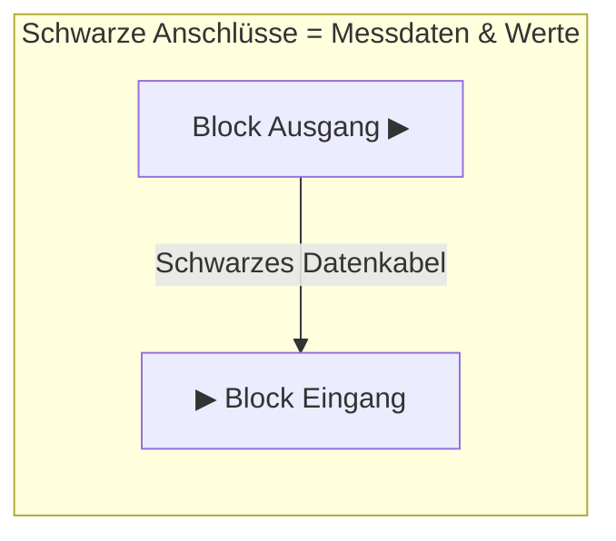
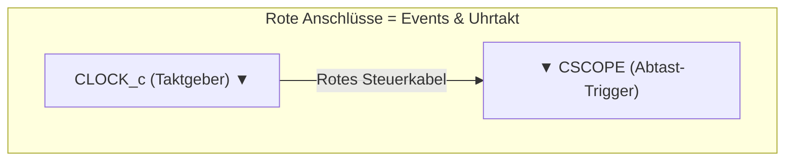

# Modul 6: Einführung in Xcos – Die bunte Blockwelt

Willkommen in **Xcos**! Wenn du bisher gedacht hast, dass Modellieren und Simulieren immer bedeutet, endlose Codezeilen zu tippen, wirst du Xcos lieben.

In Xcos baust du Modelle wie mit **virtuellen Lego-Bausteinen**:
* Du nimmst Funktionsblöcke (z. B. eine Signalquelle, einen Rechner oder ein Oszilloskop),
* ziehst sie mit der Maus auf ein Arbeitsblatt,
* und verbindest sie mit Leitungen.

Dieses Prinzip nennt man **Signalfluss-Modellierung** – genau so arbeiten Entwicklungsingenieure bei Autoherstellern, Flugzeugbauern und in der Raumfahrt!

---

## 1. Xcos starten

Öffne Scilab und tippe in die Konsole einfach folgenden Befehl ein (und drücke Enter):

```scilab
--> xcos
```
*(Alternativ kannst du in der Werkzeugleiste oben auf das Xcos-Symbol klicken).*

Es öffnen sich zwei neue Fenster:
1. **Der Paletten-Browser (Palette Browser):** Dein Bauteile-Lager. Hier findest du sortiert nach Kategorien alle verfügbaren Funktionsblöcke.
2. **Der Diagramm-Editor (Untitled - Xcos):** Dein Arbeitsblatt. Hier baust du deine Schaltung auf.

---

## 2. Die wichtigsten Paletten im Überblick

Für unsere Physik- und Mathe-Simulationen brauchen wir vor allem vier Paletten:

| Palette | Enthält... | Typische Blöcke |
| :--- | :--- | :--- |
| **Sources (Quellen)** | Signalerzeuger, Generatoren, Zeitgeber | `CONST_m` (Konstante), `GENSIN_f` (Sinuswelle), `CLOCK_c` (Taktgeber), `RAMP` (Rampe) |
| **Sinks (Senken / Ausgaben)** | Messgeräte, Displays, Oszilloskope | `CSCOPE` (Oszilloskop-Bildschirm), `TOWS_c` (Daten zurück nach Scilab senden) |
| **Continuous (Kontinuierlich)** | Physikalische Rechenblöcke | `INTEGRAL_m` (Integrator – unser wichtigster Block!), `DERIV` (Ableiter) |
| **Math operations (Mathematik)** | Grundrechenarten & Funktionen | `SUMMATION` (Addieren/Subtrahieren), `GAINBLK` (Multiplizieren mit festem Faktor), `PRODUCT` |

---

## 3. Die goldene Regel: Schwarze vs. Rote Leitungen!

Schau dir die Blöcke in Xcos genau an. Du siehst kleine Dreiecke an den Rändern – die Anschlüsse (Ports). Es gibt zwei völlig unterschiedliche Leitungsarten:





> [!IMPORTANT]
> **Die zwei Signalarten:**
> 1. **Schwarze Anschlüsse (seitlich - links/rechts):** Transportieren **Zahlenwerte** (z. B. Kraft, Geschwindigkeit, Spannung).
> 2. **Rote Anschlüsse (oben/unten):** Transportieren **Taktsignale (Events)**. Sie sagen einem Messgerät: *„Jetzt im Moment einen Messpunkt aufnehmen und den Bildschirm aktualisieren!“*  
> **Achtung:** Ein schwarzer Anschluss kann niemals mit einem roten Anschluss verbunden werden!

---

## 4. Unser „Hallo Welt“-Projekt: Ein virtuelles Oszilloskop

Wir bauen jetzt unsere erste Schaltung: Ein Sinusgenerator erzeugt eine Schwingung, die wir live auf einem Oszilloskop (`CSCOPE`) beobachten.

### Schritt 1: Blöcke auf das Arbeitsblatt ziehen
Öffne den Paletten-Browser und ziehe folgende drei Blöcke per Drag & Drop auf dein leeres Arbeitsblatt:

1. Aus **Sources**: Den Block `GENSIN_f` (Sinus-Generator).
2. Aus **Sinks**: Den Block `CSCOPE` (Oszilloskop-Anzeige).
3. Aus **Sources** (oder **Events**): Den Block `CLOCK_c` (Taktgeber-Uhr).

### Schritt 2: Blöcke verdrahten
* Klicke auf den **schwarzen Ausgangspfeil (rechts)** von `GENSIN_f`, halte die Maustaste gedrückt und ziehe die Leitung zum **schwarzen Eingangspfeil (links)** von `CSCOPE`.
* Klicke auf den **roten Ausgangspfeil (unten)** von `CLOCK_c` und ziehe die Leitung zum **roten Steuereingang (oben)** von `CSCOPE`.

So sieht dein Modell schematisch aus:

```
  +--------------+            +------------+
  |   GENSIN_f   |----------->|   CSCOPE   |
  | (Sinusquelle)|  (schwarz) |(Oszilloskop|
  +--------------+            +------------+
                                     ^
                                     | (rot)
                              +------------+
                              |  CLOCK_c   |
                              | (Taktgeber)|
                              +------------+
```

---

### Schritt 3: Parameter einstellen (Doppelklick)

Jeder Block lässt sich mit einem **Doppelklick** konfigurieren:

1. **Doppelklick auf `GENSIN_f`:**
   * `Magnitude` (Amplitude): `2.0` (die Welle schwingt zwischen $+2$ und $-2$).
   * `Frequency` (Kreisfrequenz in rad/s): `1.0`.
   * Mit **OK** bestätigen.
2. **Doppelklick auf `CSCOPE`:**
   * `Ymin`: `-2.5`
   * `Ymax`: `2.5`
   * `Refresh period`: `30` (Zeitfenster auf der x-Achse: 30 Sekunden).
   * Mit **OK** bestätigen.
3. **Simulationszeit anpassen:**
   * Klicke im Menü des Diagramm-Editors auf **Simulation $\rightarrow$ Setup...** (oder drücke die Tastenkombination).
   * Ändere `Final integration time` von $100000$ auf handliche `30` (Sekunden).

---

### Schritt 4: Film ab! Die Simulation starten

Klicke in der Menüleiste auf das grüne **Play-Symbol ▶** (Start).

**Was passiert?**  
Es öffnet sich ein neues Fenster mit einem echten Oszilloskop-Bildschirm, auf dem in Echtzeit eine perfekte grüne Sinuswelle von links nach rechts gezeichnet wird!

Mit dem Pause-Button kannst du die Simulation anhalten, mit dem Stopp-Button ganz beenden.

---

## 5. Experimentier-Labor: Was passiert, wenn...?

Verändere nun spielerisch die Einstellungen:

1. **Schnellere Welle:**  
   Doppelklicke auf `GENSIN_f` und erhöhe die Frequenz auf `5.0`. Klicke erneut auf Play. Die Welle schwingt jetzt viel schneller hin und her.
2. **Höhere Amplitude:**  
   Setze die Magnitude auf `5.0`. Passe im `CSCOPE` die Achsen auf `Ymin = -6` und `Ymax = 6` an, damit die Spitzen nicht oben und unten abgeschnitten werden!
3. **Mehrere Signale gleichzeitig anzeigen:**  
   Der `CSCOPE`-Block kann sogar zwei Kurven gleichzeitig darstellen (z. B. mit einem `MUX`-Block aus der Palette *Signal routing*). Das schauen wir uns in den nächsten Modulen an!

---

## 6. Das Modell speichern

Vergiss nicht, dein Modell abzuspeichern:
* Klicke auf **Datei $\rightarrow$ Speichern unter...**
* Speichere es als `01_hallo_xcos.zcos` ab.
*(Xcos speichert Schaltungen als `.zcos`- oder `.xcos`-Dateien).*

---

## 7. Zusammenfassung: Das Xcos-Rezept für jedes Modell

1. **Was ist die Eingabe?** $\rightarrow$ Block aus der Palette **Sources** wählen.
2. **Was soll gerechnet werden?** $\rightarrow$ Blöcke aus **Math operations** oder **Continuous**.
3. **Wie will ich das Ergebnis sehen?** $\rightarrow$ `CSCOPE` aus **Sinks** anschließen.
4. **Den Takt nicht vergessen!** $\rightarrow$ `CLOCK_c` immer mit der roten Steuerleitung an das Scope anschließen.
5. **Starten:** Grüner Play-Button ▶.
