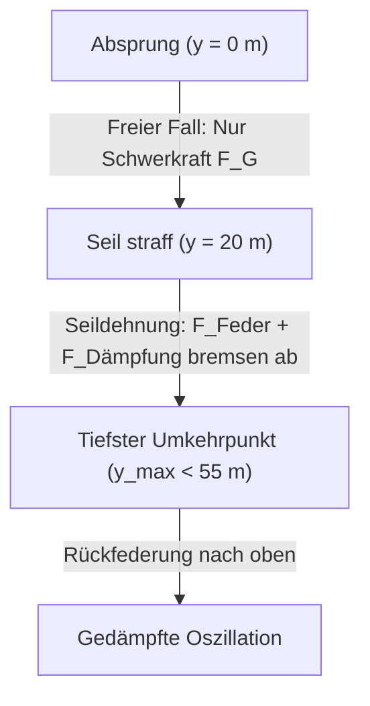

# Schüler-Projekt C: Der Bungee-Sprung
**Fachbereich:** Physik (Mechanik, Energieformen, Schwingungen) & Xcos-Simulation  
**Schwierigkeitsgrad:** Anspruchsvoll / Forscheraufgabe (10. Klasse)

---

## 🌉 Die Ausgangssituation

Ein Bungee-Sprung von einer Brücke gehört zu den spektakulärsten Extremsportarten der Welt. Doch damit der Sprung ein unvergessliches Erlebnis wird und nicht im Krankenhaus endet, muss die Physik bis ins kleinste Detail stimmen!

Du bist die leitende Sicherheitsingenieurin bzw. der leitende Sicherheitsingenieur für eine Sprunganlage an einer **$60\,\text{Meter}$ hohen Brücke**.

### Die Daten der Anlage:
* **Höhe der Absprungplattform:** $H = 60\,\text{m}$ über dem Flussbett.
* **Masse des Springers:** $m = 75\,\text{kg}$.
* **Ungedehnte Seillänge:** $L_0 = 20\,\text{m}$.  
  *(Das Seil ist die ersten 20 Meter völlig schlaff – hier herrscht reiner freier Fall!).*
* **Sicherheitsabstand zur Wasseroberfläche:** Mindestens **$5\,\text{Meter}$** (der Tiefstpunkt darf maximal bei $y_{\text{max}} = 55\,\text{m}$ liegen).

---

## ⚖️ Die physikalischen Phasen des Sprungs

Beim Bungee-Sprung wirken je nach Position unterschiedliche Kräfte:

1. **Phase 1: Freier Fall ($y < 20\,\text{m}$):**
   Das Seil übt keinerlei Kraft aus ($F_{\text{Seil}} = 0$).  
   Einzig die Schwerkraft wirkt: $F = m \cdot g \implies a = g = 9{,}81\,\text{m/s}^2$.
2. **Phase 2: Seildehnung & Bremsphase ($y \ge 20\,\text{m}$):**
   Sobald der Springer tiefer als $20\,\text{m}$ fällt, dehnt sich das Gummiseil um die Strecke $\Delta L = (y - 20)$.  
   Die Federkraft zieht nach oben:
   $$F_{\text{Feder}} = -D \cdot (y - 20)$$
   Zusätzlich dämpft die innere Seilreibung die Bewegung ab:
   $$F_{\text{Dämpfung}} = -d \cdot v$$
3. **Gesamtkraft ab 20 m:**
   $$F_{\text{gesamt}} = m \cdot g - D \cdot (y - 20) - d \cdot v$$

---

## 🛠 Deine Projektaufgaben

### Aufgabe 1: Theoretische Vorab-Abschätzung mit Energieerhaltung (Mathe/Physik)
Bevor wir simulieren, schätzen wir die nötige Federhärte $D$ ab:
* Am Tiefstpunkt ($y_{\text{max}} = 55\,\text{m}$) hat sich die gesamte potentielle Energie der Höhe in Spannenergie des Gummiseils verwandelt:
  $$E_{\text{pot}} = m \cdot g \cdot y_{\text{max}}$$
  $$E_{\text{Spann}} = \frac{1}{2} \cdot D \cdot (y_{\text{max}} - L_0)^2$$
* Setze $E_{\text{pot}} = E_{\text{Spann}}$ und stelle nach der Federhärte $D$ um:
  $$D = \frac{2 \cdot m \cdot g \cdot y_{\text{max}}}{(y_{\text{max}} - L_0)^2}$$
* Berechne $D$ in der Scilab-Konsole für $m = 75$, $g = 9{,}81$, $y_{\text{max}} = 55$, $L_0 = 20$.  
*(Erwartungswert: ca. $66$ bis $70\,\text{N/m}$).*

### Aufgabe 2: Das Xcos-Simulationsmodell aufbauen
In Xcos bauen wir das System mit der echten Fall- und Rückfederungsdynamik auf:

1. **Zwei Integratoren in Serie:**
   * Integrator 1 liefert die Fallgeschwindigkeit $v(t)$ (Startwert $0$).
   * Integrator 2 liefert die Falltiefe $y(t)$ (Startwert $0$).
2. **Die Seilkraft-Bedingung modellieren:**
   * Verwende aus der Palette *Math operations* den Block `SUMMATION` mit Vorzeichen `[1; -1]`, um $(y - 20)$ zu berechnen.
   * Verwende aus *Math operations* den Block `MAX_f`, um negative Werte abzuschneiden: Wenn $y < 20$ ist, liefert er $0$; wenn $y \ge 20$ ist, liefert er die echte Seildehnung!
   * Führe das Ergebnis über einen `GAINBLK` (Federhärte $D/m$).
3. **Dämpfung einbinden:**
   * Greife die Geschwindigkeit $v$ ab, führe sie über einen `GAINBLK` mit Dämpfungswert $d/m = 0{,}15$.
4. **Schwerkraft addieren:**
   * `CONST_m` mit $g = 9{,}81$.
5. **CSCOPE anschließen:**
   * Zeige die Falltiefe $y(t)$ über eine Simulationszeit von 25 Sekunden an.

### Aufgabe 3: Der Sicherheits-Check
1. Starte die Simulation in Xcos.
2. Schlägt der Springer auf dem Wasser auf oder hält das Seil den Sicherheitsabstand von mindestens 5 Metern ein?
3. Wie viele Male federt der Springer auf und ab, bis er ruhig am Seil hängt?
4. **Physikalischer Härtetest (Die g-Kräfte):**  
   Schließe auch die Beschleunigung $a(t)$ an ein Scope an. Welche maximale Beschleunigung (in $g = 9{,}81\,\text{m/s}^2$) wirkt im tiefsten Umkehrpunkt auf den Körper des Springers? Hält ein Mensch diese Belastung problemlos aus?
